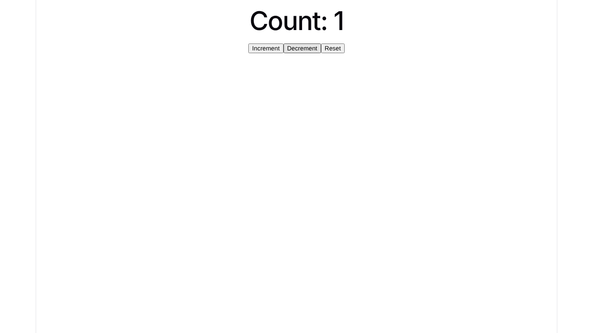

# Defect Report

## DEF-001 — Decrement button increases the count instead of decreasing it

| Field | Detail |
|---|---|
| **Defect ID** | DEF-001 |
| **Title** | Decrement button increases the count by 1 instead of decreasing it by 1 |
| **Related test cases** | **TC-03** (primary), TC-04, TC-06. See [test-cases.md](test-cases.md). |
| **Requirement** | R3: each click of Decrement decreases the count by exactly 1 ([test plan](test-plan.md#1-application-overview)) |
| **Component** | `StarterLab04/counter-app/src/App.tsx`, Decrement button |
| **Date found** | 2026-11-23 |
| **Severity** | **High** |
| **Priority** | **High** |
| **Status** | **Open** (not fixed) |
| **Reproducibility** | Always: 12 of 12 attempts (see below) |

### Test Environment

| Component | Version / Detail |
|---|---|
| Operating system | Ubuntu 24.04.5 LTS (Linux 6.18) |
| Node.js / npm | 22.23.5 / 10.9.9 |
| React / Vite | 19.3.0 / 8.3.1 (dev server, `npm run dev`, `http://localhost:5173/`) |
| Browser | Chromium 157.0.8103.78 (headless, driven by Playwright) |
| Component tests | Vitest 5.1.1 + React Testing Library 16.3.3 in jsdom 31.0.1 |
| Build | Unmodified starter code from `StarterLab04.zip` |

### Preconditions

1. Dependencies are installed (`npm install` in `StarterLab04/counter-app`).
2. The app is running (`npm run dev`) and open at `http://localhost:5173/`.
3. The page has just been loaded or refreshed, so the heading shows **`Count: 0`**.

### Steps to Reproduce

**Scenario 1: Decrement from 0 (TC-03)**

1. Load the app and confirm the heading shows `Count: 0`.
2. Click **Decrement** once.
3. Read the heading.

**Scenario 2: Decrement from a positive value (TC-04)**

1. Load the app and confirm the heading shows `Count: 0`.
2. Click **Increment** twice. The heading shows `Count: 2`.
3. Click **Decrement** once.
4. Read the heading.

### Expected Result

- Scenario 1: the heading shows **`Count: -1`**.
- Scenario 2: the heading shows **`Count: 1`**.

Decrement should reduce the count by exactly 1.

### Actual Result

- Scenario 1: the heading shows **`Count: 1`**.
- Scenario 2: the heading shows **`Count: 3`**.

Decrement **adds** 1 to the count, so it behaves exactly like Increment. The same thing happens in the sequence test TC-06: after Increment ×3, Decrement gives `Count: 4` instead of `Count: 2`.

Screenshot (Chromium) after one click of Decrement on a freshly loaded page. The expected value is `Count: -1`:



### Reproduction Result

| Method | Attempts | Failed | Actual value observed |
|---|---|---|---|
| Real browser (Chromium), TC-03 / TC-04 / TC-06 | 3 each (9 total) | 9 / 9 | Always `1` / `3` / `4` |
| Automated component tests (Vitest), TC-03 / TC-04 / TC-06 | 3 runs | 3 / 3 runs (all three tests failed in each run) | Always `1` / `3` / `4` |

The defect reproduced on **every** attempt with the same wrong value, so it is **consistently reproducible**. Full output is in [`evidence/`](evidence/) and summarized in [test-execution.md](test-execution.md#4-reproduction-attempts-for-failed-tests).

### Severity — High

The defect breaks one of the app's three core functions entirely. Decrement never works, gives a wrong value on every click, and leaves the user with an incorrect count. There is no crash or data loss, so it is not rated Critical. Still, a counter that cannot count down fails a major part of its purpose. The only workaround is to press Reset and count back up with Increment, which is not a reasonable replacement for a missing feature.

### Priority — High

This should be fixed before any release:

- The defect is on the main screen and appears the first time anyone clicks Decrement, so every user will run into it.
- It makes users distrust the value shown.
- The likely fix is small and low risk (see the developer note), so fixing it now costs little.

### Notes for the Developer (Root-Cause Hint)

This defect was found by running the tests, not just by reading the code. Looking at the code afterwards suggests the probable cause in `src/App.tsx`. The Decrement button's click handler is identical to Increment's:

```tsx
<button onClick={() => setCount(count + 1)}>Increment</button>
<button onClick={() => setCount(count + 1)}>Decrement</button>   {/* adds 1 instead of subtracting 1 */}
```

The probable fix is for the Decrement handler to subtract 1. **This fix has not been applied.** Changing the application was outside the scope of this lab.

### Status History

| Date | Status | Notes |
|---|---|---|
| 2026-11-23 | **Open** | Found during test cycle 1 and confirmed in both real-browser and automated testing. Waiting for a fix. |

**After a fix:** run confirmation tests (TC-03, TC-04, TC-06) and regression tests (TC-01, TC-02, TC-05) as described in [test-execution.md §6](test-execution.md#6-confirmation-testing-planned-after-a-fix). Mark the defect Closed only if all of them pass.
